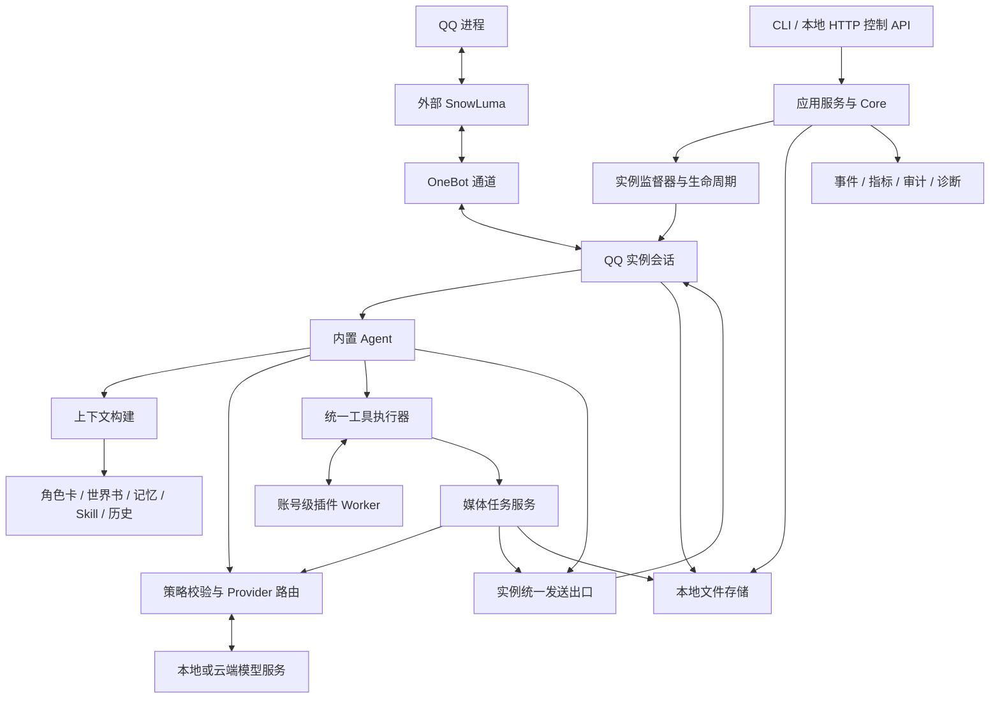
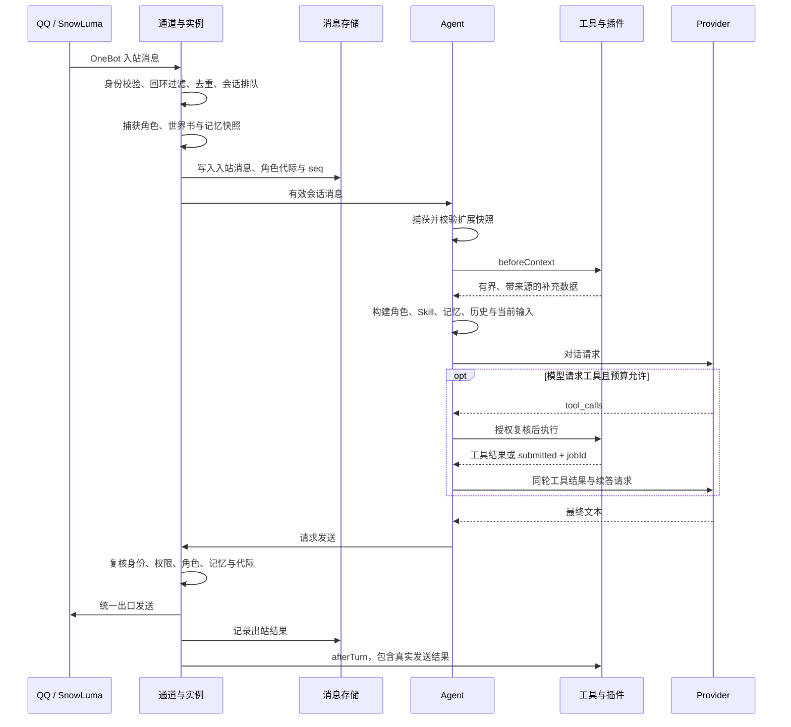

# nowadays 总体架构与功能文档

> 文档日期：2026-10-27。
> 依据：当前仓库源码，基线提交 `5454301`，`package.json` 版本 `0.2.4`。
> 范围：系统架构、后端功能、核心流程、数据组织、接口与运行边界。不包含前端技术、页面设计和交互实现。
> 状态：开发中。本文描述当前实现，不将历史方案或待验收项目视为已完成的生产能力。

## 1. 系统定位

nowadays 是一个以 QQ 为消息入口、以 AI Agent 为自动回复主体的本地多账号运行系统。

系统通过外部 SnowLuma 接入 QQ 进程，通过 OneBot 通道收发消息，为每个 QQ 账号组织独立的运行会话、角色配置、消息历史、插件状态、记忆和媒体任务。模型能力由统一 Provider 路由提供，支持本地或云端模型服务。

主要目标：

- 同时管理多个 QQ 账号，隔离账号身份、消息、配置和运行故障。
- 为私聊和群聊分别绑定角色，按会话决定是否自动回复及可使用的能力。
- 将角色卡、世界书、长期记忆、Skill 和工具调用组合为有预算的 Agent 上下文。
- 在统一权限、并发和代际校验下执行插件工具与媒体任务。
- 通过本地控制 API 提供管理、事件订阅和运行诊断。

## 2. 总体架构

### 2.1 架构形态

系统采用**本地模块化单体 + 插件 Worker 隔离**的架构。

主进程中的 Core 装配账号、实例、通道、模型路由、存储和应用服务；插件代码放入独立 Worker 执行；QQ/SnowLuma 和模型服务位于 Core 之外。主业务数据保存在本地文件系统，当前不依赖关系型数据库、向量数据库或外部消息队列。



图中箭头表示主要调用或数据流。各能力共享同一个 Core 容器；媒体任务与对话请求使用分开的调度资源。

### 2.2 分层与模块职责

| 层级或模块 | 主要目录 | 职责 |
| --- | --- | --- |
| 入口与装配 | `src/bin/`、`src/bootstrap/` | CLI 启动、依赖装配、资源初始化与初始化失败清理 |
| 核心容器 | `src/core/` | Core 门面、事件总线、指标、审计、资源锁、错误与运行限制 |
| 应用服务 | `src/application/` | 账号、连接、部署、模型设置、世界书、记忆和扩展的业务用例编排 |
| 应用端口与数据契约 | `src/application/ports/`、`src/contracts/` | 控制面与运行时之间的类型边界、业务请求和响应结构 |
| 实例与运行时 | `src/instances/` | 账号租约、实例状态机、收敛监督、runtime 共享及生命周期 |
| QQ 接入 | `src/injection/` | SnowLuma 管理接口、进程探测、手动注入、监听、附着和卸载请求 |
| 消息通道与路由 | `src/channels/`、`src/routing/`、`src/work/` | OneBot 通信、事件规范化、身份与回环校验、会话队列及限流 |
| Agent 与内部宿主契约 | `src/agent/`、`src/host/` | 对话调度、上下文构建、模型续答、工具编排及内部宿主端口 |
| 模型与策略 | `src/providers/`、`src/policy/` | Provider 配置、能力绑定、授权、适配器、请求限流与回退 |
| 扩展系统 | `src/extensions/` | 插件声明、Worker 协议、工具执行器、调用账本与 Skill 选择 |
| 账号与制品 | `src/profiles/`、`src/artifacts/` | 账号档案、会话角色绑定、公私有资源、导入、版本发布与滚动部署 |
| 世界书与记忆 | `src/worldbook/`、`src/memory/` | 资源结构、关键词匹配、事实检索、状态存储与预算控制 |
| 媒体与任务 | `src/media/`、`src/jobs/` | 账号媒体文件、下载校验、异步任务、取消、状态和结果投递 |
| 基础设施 | `src/storage/`、`src/platform/`、`src/secrets/` | 文件持久化、原子写、串行执行、HTTP 体积限制、脱敏与凭据端口 |
| 本地控制面 | `src/service/` | HTTP 路由、鉴权、SSE、错误映射与管理操作审计 |

`Core` 实现 `CoreView` 控制端口，将外部请求转交给对应应用服务，并协调运行中的实例。该结构已有显式分层，但 Core 仍承担较多装配和运行协调职责，并非所有依赖都已完全反转。

### 2.3 核心对象与隔离单位

| 对象 | 含义 | 生命周期或作用域 |
| --- | --- | --- |
| Core | 一套独立的运行容器 | 每次 `createCore()` 创建；没有模块级业务单例 |
| dataRoot | 一套运行数据根目录 | 默认通过文件锁限制为单写者 |
| Runtime | SnowLuma 后端资源 | 通常按 `runtimeDir` 聚合、引用计数共享 |
| Instance / Slot | 承载连接和策略的运行槽位 | 可以预先指定账号，也可在连接后绑定账号 |
| AccountSession | 账号绑定后的运行会话 | 一个 QQ 号、一条通道、一份账号数据命名空间 |
| Conversation | 私聊对象或群聊 | `accountId + kind + peerId`，其中 `kind` 为 `private` 或 `group` |
| contextEpoch | 角色历史代际 | 将同一会话中不同角色时期的历史、记忆和默认插件状态隔开 |
| Plugin Worker | 某个账号下的一个插件运行体 | 按账号、插件来源、插件 id 和运行代际管理 |

同一 Core 内，一个 QQ 账号只能被一个实例持有。槽位停止并释放绑定后，下次可以连接其他账号；账号历史不会随槽位身份混用。当前没有跨进程账号租约。

## 3. 功能范围

### 3.1 QQ 接入与连接管理

- 探测 SnowLuma 管理服务、QQ 进程、账号身份和注入状态。
- 支持用户触发“注入并监听”“直接监听”“刷新状态”和“请求卸载”。
- 对手动注入维护操作状态，校验进程身份，减少 PID 复用或账号变化导致的误操作。
- 保存连接设置和监听记录；管理密码通过凭据库保存。
- 对同一 runtime 共享后端资源，同时隔离不同账号的熔断状态。
- QQ 与 SnowLuma 由用户预先准备并启动，系统不自动部署或启动 SnowLuma，也不自动启动 QQ。

### 3.2 多账号与实例管理

- 创建、删除、启动、停止槽位，持久化槽位规格和运行意图。
- 监督器按 desired/observed 状态收敛，执行健康检查、退避重启及重启预算限制。
- 每实例的启动、停止和重启串行执行；停止可取消在途启动。
- 同批启动中的单实例失败不阻断其他实例。
- 账号资料、角色卡、插件配置和昵称等数据可在离线时保留和管理。
- 暂停 Agent 只停止自动处理，连接、历史接收和人工发送仍可保留。

### 3.3 消息收发与历史

- 将 OneBot 消息转为统一入站事件，支持私聊、群聊及文本、图片、视频、语音等消息片段的处理与传递；具体发送能力以通道支持为准。
- 按实例归属检查 `self_id`，过滤本账号发送回声，拒绝错误归属事件；其他账号发来的消息可以正常接收。
- 入站采用有界队列、会话串行和 `messageId` 去重；优先持久化后再交给宿主。
- 出站采用会话 FIFO、账号令牌桶和 `idempotencyKey` 去重。
- 提供会话列表、历史读取和人工发送；发送结果随调用返回。
- 消息历史采用分段 JSONL 和会话序列号 `seq`，按账号与会话组织。

入站落盘失败会报告 `persist_failed`，仍可交给宿主处理。出站已发送但落盘失败时，不将其伪装成“尚未发送”来诱导调用方重试。当前没有持久化 outbox，不能保证跨进程重启的可靠重投递。

### 3.4 角色卡与会话角色

- 支持公用、账号私有角色卡，以及酒馆角色卡导入。
- 制品以 `source + id + revision` 标识；省略 revision 的引用可跟随 catalog，显式 revision 则固定版本。
- 账号档案主要保存插件集合；旧 `roleCard` 字段仅保留为迁移信息，不参与运行时角色回退。档案文件缺失时按空插件集合处理，档案损坏或已启用插件不可解析时实例可停留在 `awaiting_profile`。
- 自动回复要求每个私聊或群聊有有效的显式角色绑定。缺少会话绑定时，不自动使用账号旧角色字段代替。
- 角色绑定或实际解析的角色版本变化会改变历史代际，旧角色的在途回复不能交付到新角色会话。
- 原始历史仍保留，但 Agent 读取历史时按当前角色代际过滤。

### 3.5 模型服务与能力路由

当前有五类能力，统一以能力 id 进行策略和路由判断：

| 能力 id | 功能 | 典型输入与输出 |
| --- | --- | --- |
| `chat` | 文本对话与工具调用 | 规范化上下文 → 文本或工具调用协议 |
| `image.understand` | 图片理解 | 图片与问题 → 带来源的观察文本 |
| `video.understand` | 视频理解 | 视频与问题 → 观察、摘要或时间片 |
| `image.generate` | 图片生成 | 提示词 → 图片媒体制品 |
| `audio.generate` | 语音生成 | 文本与音色配置 → 音频媒体制品 |

Provider 声明端点、适配器、模型、能力、输入类型、工具支持、凭据引用、限额、超时和重试策略。模型是否可用以配置声明和运行校验为准，不通过名称猜测。

| 适配器 | 当前接口范围 |
| --- | --- |
| `openai-compatible-v1` | `/chat/completions`、`/images/generations`、`/audio/speech`；视频理解还要求服务支持 `video_url` 输入 |
| `video-polling-v1` | 视频任务提交、轮询和尽力而为的远端取消 |
| `fake-v1` | 可脚本化本地测试适配器 |

同一 `baseUrl` 的请求共享端点并发限制。路由在请求、重试和回退前复核当前授权、配置与凭据版本，避免旧计划继续使用已撤销权限。对生图、语音等可能已产生费用但响应丢失的请求，以“远端结果未知”处理，避免盲目重复提交。

### 3.6 账号授权与分层策略

权限分为账号硬授权和作用域配置：

- **账号硬授权**：允许的 Provider、是否允许媒体上传云端、是否允许跨 Provider 回退。
- **作用域配置**：账号默认 → 私聊/群聊类型 → 指定会话，控制 Agent、能力开关、模型绑定及扩展启停。
- **运行复核**：自动回复、工具执行、媒体提交和结果交付前再次校验当前状态。

会话级配置不能越过账号硬授权。有效状态查询同时返回可用性、不可用原因、配置来源和实际绑定，不只返回保存值。

通用配置的历史合并层级为 `global → account → kind → account:kind → conversation`；模型与能力策略保存在独立的 V2 配置中。

### 3.7 Agent 对话编排

内置 Agent 是账号唯一的自动回复主体。插件通过工具、钩子和 Skill 参与，不能独立接管发送出口。

一轮对话按当前会话捕获角色、世界书、记忆和扩展状态，再构建有预算的模型输入：

1. 角色设定及匹配的世界书内容。
2. 当前有效 Skill 和事实记忆。
3. 当前角色代际下的有界历史。
4. 当前用户消息、媒体观察和插件补充数据。

当前消息仅加入一次。群聊内容保留发送者标识，媒体观察和插件补充内容带来源标记；插件补充内容不进入 system 指令区。

模型可以进行多轮工具续答，当前默认上限为每轮最多 4 次模型请求、3 个工具回合、4 次工具调用。被拒绝的工具调用同样消耗预算；最后一次模型请求不再提供工具。工具协议只在本轮使用，不写入长期消息历史，中间文本不提前发送，一轮同步对话最终只发一条回复。

图片可先通过独立识图形成观察数据，也可在 `visionMode=direct` 下交给支持图片输入的对话模型。关闭图片理解时，两条路径都受限。视频通过异步任务理解，完成后回到原会话追加对话；生图也支持 `/draw`、`!draw`、`/img`、`!img` 显式命令。

### 3.8 世界书

- 支持独立世界书资源，以及角色卡内嵌世界书。
- 支持原生 JSON、酒馆数组和酒馆对象格式导入。
- 条目支持关键词、正文、常驻、大小写规则、优先级和角色前后注入位置。
- 每个会话选择角色卡内嵌来源或某个独立世界书版本，二者不自动叠加。
- 匹配当前文本和限定深度的历史，限制扫描工作量及注入字符预算。
- 编辑保存生成不可变新版本；已有会话不自动切到新版本。
- 草稿与会话预览复用运行时匹配器，仅使用调用方提供的测试文本，不读取真实历史、不调用模型、不写入记忆。
- 已启用的世界书缺失或损坏时，阻止该轮自动回复并报告原因。

世界书配置变化会使旧轮次失效，但不会仅因世界书变化而切换角色历史和记忆命名空间。

### 3.9 长期记忆

记忆作用域为 `accountId + kind + peerId + contextEpoch`，不跨账号、会话或角色代际共享。

当前实现包括：

- 记忆设置、记录增删改查、固定、清空和命中预览。
- 通过 revision、generation 和请求回执控制并发修改与重复提交。
- 按关键词匹配事实，优先选择固定记录，再结合更新时间和字符、条数预算注入。
- 每轮使用只读快照，发送前检查记忆 guard，拒绝记忆已变化后的旧结果。
- 支持 `fact`、`summary` 两种存储类型；当前运行检索仅注入 `fact`，不会自动注入 summary。

自动提取默认关闭，需显式激活。提取只处理激活水位之后符合条件的新增文本，在合格回复完成后异步触发；带插件补充数据或工具协议的轮次不作为事实候选。

默认提取门槛为新增 6 条合格用户文本、两次尝试至少间隔 5 分钟，全局最多 2 个并发。默认每账号每小时最多 12 次、全局每小时最多 30 次；请求前先占配额，失败也计数。该配额限制调用次数，不等同于金额预算。

提取固定为单次模型调用，不自动重试或跨 Provider 回退；输出校验、作用域和代际复核通过后才写入事实并推进水位。删除、清空、停用、容量或写入异常可暂停后续提取，防止失效状态继续发起请求。

### 3.10 插件、工具与 Skill

| 扩展类型 | 作用 | 执行边界 |
| --- | --- | --- |
| Tool | 执行查询或动作 | 统一执行器校验身份、参数、授权、预算、handler 就绪和代际 |
| Hook | 对话前后补充处理 | `beforeContext` 返回带来源数据；`afterTurn` 接收真实发送结果 |
| Skill | 向当前对话提供任务说明和工具引用 | 参与上下文选择，本身不会获得工具授权 |

插件通过 manifest 声明工具、钩子、Skill 和状态版本，入口模块提供对应 handler。运行时进行声明与 handler 握手；未声明导出不能成为工具，历史握手成功也不代表当前 Worker 仍就绪。

每账号每插件一个 Worker。同一插件内钩子与工具串行，其他插件和账号按并发限制运行。钩子默认单次 500ms，每轮前后钩子共用 2s 预算；模型等待不计入该预算。Worker 超时可被终止，旧代际的迟到结果和状态写入会被拒绝。

插件拿不到 Core 的 bus、消息存储、后端、凭据或直接发送端口。插件状态默认按会话及角色代际隔离，可按声明启用账号共享状态。Worker 提供生命周期与故障隔离，**不是执行不可信代码的安全沙箱**。

内置 `generate_image` 与 `generate_speech` 通过统一执行器提交媒体任务，返回 `submitted + jobId`。调用账本与媒体任务共同去重；Provider 的 callId 仅用于本轮协议配对，不能作为跨消息的业务幂等键。

Skill 支持公用定义、账号私有定义和插件定义。相同 id 的私有定义覆盖公用定义，插件使用独立命名空间；支持 CRUD、复制、影响分析、并发版本检查和只读有效预览。新建及复制默认关闭，显式作用域设置可决定启停。

Skill 按私有 → 公用 → 插件的顺序选择，来源内按完整 id 排序；最多 8 项、累计 16000 字符，单条正文最多 8000 字符、最多引用 8 个工具。引用工具未授权、handler 未就绪或插件停用时不注入。实际模型请求还会按上下文剩余预算进一步收紧。

### 3.11 媒体与异步任务

媒体按账号保存，提供受控下载、类型与大小校验、索引、读取、删除和过期清理。远程下载限制重定向和私网目标等访问边界；生成结果支持可获取的 URL 或 base64，不接受远端文件系统路径作为可用制品。

媒体任务使用独立调度队列，支持排队、执行、等待远端、取消和结果投递：

```text
queued → running → waiting_remote → succeeded
            └───────────────→ succeeded / failed / cancelled
进程重启时遗留的非终态任务 → interrupted
```

`waiting_remote` 是可选阶段，图示为主要路径。任务执行状态和投递状态分别保存；生成成功不代表已成功发送到 QQ。

取消能力由适配器声明为 `remote`、`localOnly` 或 `none`。本地停止等待不代表远端付费任务已取消。重启后不会自动重新提交遗留付费任务；结果交付前继续检查账号、角色、权限和代际是否有效。

语音生成需要配置有效音色，实际语音发送还依赖通道能力；生成、发送和远端取消应分别判断。

### 3.12 制品分发与热部署

- 公用制品可以供多个账号引用，私有制品仅在所属账号目录内解析。
- 角色卡、插件按 manifest 和 revision 保存，catalog 指向当前版本。
- 公用制品部署按账号滚动：更新 catalog、解析新档案、创建新运行代际、原子切换，再排空旧代际。
- 单账号切换失败保留旧运行版本，继续处理其他账号；部署记录可以表达部分成功。
- 回滚根据 `catalog.previous.json` 恢复目录指针，再执行滚动切换。
- 保留历史 revision 供回滚，不提供长期多版本并行运行机制。

## 4. 核心运行流程

### 4.1 启动与连接

1. 入口读取启动参数，`createCore()` 通过装配模块建立服务、存储、锁和运行资源。
2. 按入口配置加载实例规格、desired 状态和可选的槽位文件。
3. Core 启动控制 API、健康检查和监督收敛。
4. 对需要运行的实例探测或附着 SnowLuma，建立 OneBot 通道。
5. 通道确认 selfId；Core 检查指定账号、账号租约和实际身份是否一致。
6. 解析账号插件档案，创建内置 Agent 与插件运行体；档案损坏或已启用插件资源未就绪时停留在 `awaiting_profile`。档案缺失本身不阻止连接上线。
7. 达到连接与档案条件后进入 `online`。每条消息仍需通过会话角色、Agent 开关和能力授权检查。

### 4.2 普通消息到自动回复



### 4.3 异步媒体与记忆提取

媒体：会话命令或工具调用 → 当前策略校验 → 创建持久化任务 → 独立队列执行/轮询 → 保存媒体或观察结果 → 复核原会话仍有效 → 统一投递。视频观察会触发原会话的后续对话。

记忆提取：合格轮次发送完成 → 合并作用域触发 → 校验激活、增量门槛、冷却与配额 → 读取有界文本批次 → 单次模型提取 → 校验结构和来源水位 → 在原会话串行链中复核并提交。

### 4.4 停止与资源释放

实例停止先暂停通道和接收，再有界排空入站、出站及旧宿主工作，随后停止宿主、断开通道并释放 runtime 和账号租约。排空超时会记录相应事件。

容器关闭由 `RuntimeLifecycle` 按 `stop → drain → dispose` 执行：先拒绝新工作，再等待在途任务，最后释放依赖。关闭幂等，单步骤失败会记录日志并继续后续释放。

## 5. 状态、并发与一致性

### 5.1 实例状态

| 状态 | 含义 |
| --- | --- |
| `stopped` | 已停止 |
| `provisioning` | 准备后端与资源 |
| `starting` | 建立通道并初始化会话 |
| `awaiting_login` | 等待账号登录或身份确认 |
| `awaiting_profile` | 账号档案损坏或已启用插件资源未就绪 |
| `online` | 连接和账号运行条件就绪 |
| `degraded` | 连接或健康状态退化 |
| `stopping` | 正在排空和释放 |
| `failed` | 启动或运行失败 |

典型路径为 `stopped → provisioning → starting → awaiting_login / awaiting_profile → online`；根据实际条件可以跳过等待状态。desiredState 独立保存为 `running` 或 `stopped`，手工停止后重启进程不会仅因历史在线而自动拉起。

### 5.2 并发控制

- 实例操作链防止启动、停止和重启交错。
- 会话队列保证同会话消息顺序，不同会话可并行。
- 对话调度器限制全局及账号并发；媒体任务使用独立并发和排队额度。
- 工具执行器、Provider 端点限流和出站令牌桶分别限制对应资源。
- 入站高水位可暂停通道，硬上限报告 `ingress_overflow`；出站队列满返回 `backpressure`，HTTP 映射为 429。

### 5.3 代际与提交检查

| 标记 | 防止的问题 |
| --- | --- |
| `sessionEpoch` | 旧账号会话的迟到操作进入新会话 |
| `hostEpoch`、`profileFingerprint` | 热更新前的宿主或配置继续提交旧结果 |
| 角色绑定 revision、`contextEpoch` | 切换角色后混入旧回复、旧历史或旧记忆 |
| 世界书 guard | 来源或内容变化后继续发送旧上下文结果 |
| 记忆 generation / guard | 删除、修改、清空记忆后旧结果仍被交付 |
| 插件运行代际、扩展快照 | 重载、撤权后旧工具结果和插件状态覆盖新状态 |

文件型配置和状态通过原子写入以及必要的串行提交控制一致性；部分业务还使用 revision 比较和 requestId 回执。原子写只保护单次文件提交，不代表整个业务流程具备跨文件事务。

## 6. 数据组织

默认布局如下，实际路径可由配置覆盖；省略缓存及临时文件：

```text
<dataRoot>/
  .accompany.lock                       # 数据根单写者锁
  config.json                           # 通用分层配置
  config.v2.json                        # Provider、账号策略、公私有 Skill 等
  injection.json                        # SnowLuma 连接设置，不保存明文密码
  slots.json                            # 槽位规格，可选持久化
  state/
    desired.json                        # 实例运行意图
    listening.json                      # 监听记录
    memory-extraction-quota.json         # 记忆提取小时配额
  public/
    catalog.json
    catalog.previous.json
    artifacts/
      role-card/<id>/<revision>/manifest.json
      plugin/<id>/<revision>/manifest.json
      worldbook/<id>/<revision>/manifest.json
  accounts/<accountId>/
    profile.json                        # 插件集合，旧角色字段仅作迁移信息
    display.json                        # 账号展示资料
    role-bindings.json                  # 会话角色及世界书配置
    catalog.json                        # 私有制品目录指针
    artifacts/                          # 私有角色卡、插件等
    messages/                           # 按会话分段的 JSONL 历史
    plugin-state/                       # 插件命名空间与作用域状态
    memory/<namespace>/state.json       # 会话、角色代际对应的记忆
    media/
      index.json                        # 账号媒体索引
      files/<mediaId>                    # 媒体内容
    jobs/jobs.json                      # 账号任务记录
  instances/<instanceId>/                # 实例运行目录
```

`namespace` 由记忆作用域生成，不是用户手写路径。公用和私有插件即使同 id，也使用不同状态命名空间。

凭据通过 `CredentialVault` 端口访问，只在配置中保存 `credentialRef`。当前桌面宿主使用系统保护能力加密保存到 `userData/credentials.json`；保护能力不可用时拒绝保存，不降级为明文。以库或 CLI 使用 Core 时，凭据能力取决于传入的 vault 实现。

## 7. 本地控制 API

控制面采用 HTTP + SSE，默认监听 `127.0.0.1`；非回环绑定必须显式提供 Bearer token。配置 token 后，除健康检查外的 API 要求授权。下表省略可选 `/v1` 前缀，为功能级索引，不是完整字段规范。

| 功能 | 代表性接口 |
| --- | --- |
| 健康与诊断 | `GET /health`、`GET /health/ready`、`GET /metrics`、`GET /diagnostics` |
| 事件订阅 | `GET /events`，支持事件续传 |
| 实例与槽位 | `GET /instances`、`GET/POST /slots`、`POST /instances/:id/start`、`POST /instances/:id/stop`、`POST /instances/:id/send` |
| QQ 接入 | `GET /injection/runtime`、`GET /injection/processes`、`POST /injection/processes/:pid/:action`、`GET /injection/operations/:id` |
| 连接设置 | `GET/PUT /injection/settings`、`POST /injection/connection/test`、`POST /injection/resume` |
| 账号档案 | `GET /accounts`、`GET/PUT /accounts/:accountId/profile`、`POST /accounts/:accountId/reload` |
| 会话角色 | `GET /accounts/:accountId/role-bindings`、`PUT/DELETE /accounts/:accountId/role-bindings/:kind/:peerId` |
| 会话与历史 | `GET /conversations`、`GET /accounts/:accountId/conversations/:kind/:peerId/messages` |
| 模型服务 | `GET/POST /providers`、`PUT/DELETE /providers/:id`、`POST /providers/:id/test`、`PUT/DELETE /providers/:id/credential` |
| 账号策略 | `GET/PUT /accounts/:accountId/policy`、`GET /accounts/:accountId/effective`、`POST /accounts/:accountId/agent` |
| 世界书资源 | `GET /worldbooks`、`GET /worldbooks/:id/revisions/:revision`、`POST /worldbooks/revisions`、`POST /worldbooks/preview` |
| 会话世界书 | `PUT /accounts/:accountId/role-bindings/:kind/:peerId/worldbook` 及其 `/preview` |
| 长期记忆 | `/accounts/:accountId/memory/:kind/:peerId` 下的 `/settings`、`/records`、`/preview`、`/clear`、`/extraction` 及激活、暂停接口 |
| 扩展管理 | `/accounts/:accountId/extensions` 及其 `/policy`、`/effective`、`/reload` |
| Skill | `/skills`、`/skills/:id/impact`、`/accounts/:accountId/skills/private`、`/accounts/:accountId/skills/effective` |
| 制品部署 | `GET /artifacts`、`POST /artifacts/:kind/:id/deploy`、`POST /artifacts/rollback`、`GET /deployments` |
| 任务与媒体 | `GET /jobs`、`POST /jobs/:id/cancel`、`GET /accounts/:accountId/media`、`GET/DELETE /accounts/:accountId/media/:id`、`POST /media/cleanup` |

接口返回 `x-api-version` 和 `x-request-id`。错误结构包含 `ok: false`、`error`、`code`，部分错误带 `retryable`；相关管理写操作记录审计。精确参数、请求体及错误映射以 `src/service/routes/` 和 `src/contracts/` 为准。

## 8. 运行与可观测性

核心代码使用 TypeScript、Node.js ESM，Node.js 版本要求为 `>=20.19`，OneBot WebSocket 通信使用 `ws`。

```powershell
# 安装依赖与构建核心
npm ci
npm run build

# 探测已准备好的 SnowLuma
npm run probe -- --runtime-dir "D:\SnowLuma"

# 使用启动配置运行核心
npm run dev -- start --config "D:\config\nowadays.json"
```

启动配置指定 `dataRoot`、实例和 API 等参数，可参考仓库根目录 `nowadays.config.example.json`。运行数据中的 `config.v2.json` 用于模型和策略，二者用途不同。`nowadays.config.v2.example.json` 只演示部分能力，完整能力枚举以 `src/policy/capabilities.ts` 为准。

系统提供结构化日志、Core 独立事件总线、事件续传、实例与 runtime 快照、队列和调度指标、管理审计及诊断汇总。事件带实例标识，凭据和敏感错误信息通过统一脱敏逻辑处理。

默认限制包括最多 32 个实例、全局 4 个对话并发、每账号 2 个对话并发、全局 4 个媒体任务并发及每账号 1 个媒体任务并发。这些是实现中的可配置上限，不是已经验证的生产容量指标。

## 9. 当前边界与验收状态

| 项目 | 当前边界 |
| --- | --- |
| 发布状态 | 开发快照，尚无稳定版承诺 |
| QQ 接入 | 依赖外部已运行的 QQ 和 SnowLuma；真实环境兼容性需实机验证 |
| 自动回复 | 需连接、可解析的账号插件配置、显式会话角色、Agent 开关和模型授权共同满足 |
| 插件隔离 | Worker 隔离故障与生命周期；插件应按受信任代码对待 |
| 消息可靠性 | 本地幂等、有限队列和尽力投递；没有持久化 outbox 或跨重启可靠重投递保证 |
| 多进程 | 数据根默认单写者；没有跨进程账号租约或分布式调度 |
| 长期记忆 | 当前以关键词事实记忆为主，未实现向量检索、情绪系统或遗忘曲线 |
| 媒体结果 | 执行成功与投递成功分离，远端取消和语音发送取决于适配器及通道 |
| 版本一致性 | 支持资源版本与运行代际校验，不提供跨文件全局事务 |
| 容量 | 并发、队列和大小有界；未据此宣称生产压测容量 |

最近的仓库验收记录 [101 EXT-G 修复独立复验](101-ext-g-fixes-independent-recheck.md) 报告：118 个测试文件、1101 项通过、1 项既有跳过，类型检查与构建通过。该结果是既有记录，本文编写时未重新执行测试，也不将其等同于真实 QQ、付费模型或发行包验收；这些仍属于 EXT-H 后续验证范围。

## 10. 代码阅读入口

| 关注点 | 入口 |
| --- | --- |
| 整体装配与对外能力 | [Core](../src/core/core.ts)、[装配模块](../src/bootstrap/assemble-runtime.ts)、[控制端口](../src/application/ports/control-api.ts) |
| QQ 接入与状态收敛 | [连接服务](../src/application/qq-connections/qq-connection-service.ts)、[实例](../src/instances/instance.ts)、[监督器](../src/instances/supervisor.ts) |
| Agent、上下文与模型 | [Agent 引擎](../src/agent/engine.ts)、[上下文](../src/agent/context.ts)、[Provider 路由](../src/providers/router.ts) |
| 角色与世界书 | [账号服务](../src/application/accounts/account-service.ts)、[角色绑定](../src/profiles/role-bindings.ts)、[世界书匹配](../src/worldbook/matcher.ts) |
| 长期记忆与提取 | [记忆服务](../src/application/memory/memory-service.ts)、[选择器](../src/memory/selector.ts)、[提取协调器](../src/application/memory/extraction/coordinator.ts) |
| 插件、工具与 Skill | [插件运行服务](../src/application/extensions/plugin-runtime-service.ts)、[工具执行器](../src/extensions/execution/executor.ts)、[Skill 服务](../src/application/extensions/skill-service.ts) |
| 媒体任务与文件持久化 | [媒体服务](../src/media/service.ts)、[任务服务](../src/jobs/service.ts)、[原子写](../src/storage/atomic-write.ts) |
| HTTP API | [服务入口](../src/service/server.ts)、[路由装配](../src/service/routes/index.ts) |

历史目标架构及分阶段执行报告用于理解演进过程；当前功能和边界以本文引用的源码及最近有效验收记录为准。
