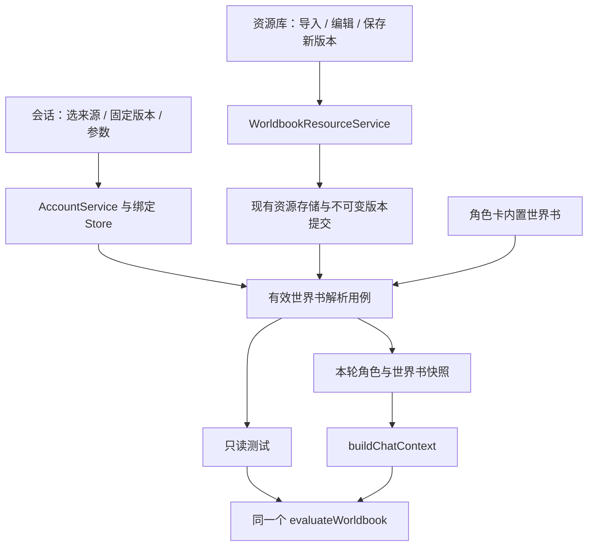

# 独立世界书与条目管理：完整实现方案

日期：2026-10-23。状态：待实施，不能作为已交付声明。

当前基础与证据见[45 世界书基础实现与验收记录](45-worldbook-foundation-review.md)。本方案与[47 验收标准](47-independent-worldbook-acceptance.md)共同作为下一阶段派发依据。长期记忆、情绪和遗忘曲线属于后续阶段，本阶段不一并实现。

## 1. 目标、范围与关键决策

用户可从资源库创建或导入独立世界书、编辑条目、保存新版本，并在指定账号的指定群聊/私聊中选用。公共层共享世界书定义，不共享会话历史或命中状态。

本阶段按以下默认决策执行，实施者不应自行扩展成另一套资源或配置系统：

| 问题 | 本阶段决策 |
| --- | --- |
| 内置书是否保留 | 保留角色卡manifest.worldbook及现有转换能力 |
| 一个会话使用几本 | 角色卡内置书或一本独立书，二选一；不叠加、多书合并 |
| 默认来源 | 未设置source时沿用角色卡内置书；未设置enabled时关闭 |
| 独立书共享范围 | 首轮只在公共资源库创建/编辑，绑定与运行数据仍逐账号、逐会话隔离；不新增私有书编辑流程 |
| 版本策略 | 保存不可变revision，绑定必须固定revision，不引入latest或自动跟随 |
| 生效方式 | 创建/导入/编辑不改变现有绑定，用户在会话中明确保存选用的版本后生效 |
| 编辑冲突 | 不原位覆盖已有revision；同一基础版本允许派生多个新revision，不声称它们是互斥CAS更新 |
| 启用策略 | 切换来源保留当前显式开关和参数，界面展示后统一保存；无书不能启用；清空来源不代表解绑角色 |
| 缺失资源 | 启用的独立书缺失/损坏时该会话自动回复停止并显示可恢复错误，不静默回退内置书；手动发送沿用原规则 |
| 资源删除 | 不提供物理删除、覆盖、垃圾回收、批量切换或自动回滚 |
| 导入兼容 | 原生世界书JSON及当前已支持字段的酒馆独立世界书JSON；不承诺完整酒馆运行时兼容 |
| 运行时能力 | 沿用字面匹配、固定预算和扫描上限，不增加正则、递归、脚本、概率、宏 |

所有新增能力都应复用当前资源解析、原子写入、串行执行器、鉴权、退出排空、公共表单和草稿保护。

## 2. 现状与需要调整的结构

当前世界书仅存在于角色卡manifest；AccountService读取绑定、解析角色卡和内置书，Agent调用buildChatContext，再调用evaluateWorldbook。ConversationRoleBindingStore保存逐会话参数与版本，世界书配置修改已与历史命名空间分离。

需要把“获取有效世界书”从“读取角色卡内置字段”抽为一个应用层解析用例，预览与运行时共同调用。matcher只接受规范化Worldbook，不关心磁盘、账号、HTTP或React。



建议职责归属（新增文件名可依现有规范微调，职责不可重复）：

| 层 | 位置 | 职责 |
| --- | --- | --- |
| 领域 | src/worldbook/schema.ts、matcher.ts、tavern.ts | 唯一schema、转换与匹配规则；新增导入格式适配仍归此层 |
| 资源 | src/artifacts/types.ts、manifest.ts、local.ts | 扩展worldbook资源kind、严格校验、安全路径和固定版本解析 |
| 应用 | src/application/worldbooks/worldbook-resource-service.ts（新增） | 预览导入、创建版本、编辑派生、查看版本详情；无HTTP/UI依赖 |
| 应用 | src/application/worldbooks/effective-worldbook.ts（新增） | 内置/独立来源解析、状态与有效版本指纹；供账号服务与运行时复用 |
| 账号 | src/application/accounts/account-service.ts | 会话配置、角色前置校验、只读测试协调 |
| 持久化 | src/profiles/role-bindings.ts | 同文件串行读改写、expectedRevision、配置版本和历史版本边界 |
| 运行时 | src/instances/instance.ts、src/agent/engine.ts、context.ts | 捕获本轮有效书与配置，发送前重验，保持历史隔离 |
| API | src/application/ports/control-api.ts、core/core.ts、service/routes | 薄接口、鉴权、错误映射、审计和退出准入，不另写规则 |
| 桌面 | desktop已有选择器/IPC与导入协调入口 | 安全文件选择、取消、读取上限和源指纹复验 |
| 前端 | 资源库编辑器、WorldbookSettings、共享contracts | 使用统一控件、草稿保护、请求与身份边界 |

不要在AccountService、Core、路由、编辑器中各写一套匹配器、schema、文件读写或新Promise队列。worldbook为纯数据资源，不进入插件worker模块入口，也不运行entry。

## 3. 数据模型与磁盘布局

### 3.1 资源定义

ArtifactKind增加worldbook。推荐将ArtifactManifest逐步收敛为按kind区分的联合类型，避免worldbook资源误要求role-card.content、误接收plugin.entry；至少必须提供等效的穷尽分支和严格校验。

原生制品示例：

```json
{
  "id": "garden-guide",
  "kind": "worldbook",
  "revision": "w-001",
  "name": "花园手册",
  "description": "公共世界设定",
  "worldbook": {
    "version": 1,
    "scanDepth": 4,
    "budgetChars": 2000,
    "entries": [{
      "id": "garden",
      "keys": ["花园", "银杏"],
      "content": "花园里有一棵银杏树。",
      "enabled": true,
      "constant": false,
      "caseSensitive": false,
      "priority": 0,
      "position": "after-role"
    }]
  }
}
```

沿用公共目录：dataRoot/public/artifacts/worldbook/<id>/<revision>/manifest.json。原始导入文件按现有归档规则保存于该revision内，不另建第二套“共享书数据库”。编辑派生只存规范化manifest及最小来源元数据，不需要反复复制大体积原始文件；原导入版本继续保留。

ID、revision复用assertArtifactSegment，限制Windows保留名、路径穿越和尾随点。worldbook字段复用parseWorldbook的200条、关键词数/长度、正文长度、总量等现有限制。空书允许保存为待编辑资源，但不能被启用；有条目但全部禁用允许保存和绑定，UI应提示实际无启用条目。

本阶段独立书仅固定版本选择，不读写worldbook的catalog当前指针，不经过现有部署/回滚的全账号worker重载。扩展ArtifactKind后逐一检查枚举、正则、过滤器、目录扫描和部署分支；通用deploy接口收到worldbook应明确拒绝，不可意外进入角色卡或插件逻辑。公共列表可展示已保存的全部版本，并标记“仅保存，需在会话选择”。

### 3.2 会话来源

保留worldbook参数原有含义，新增可选worldbookSource：

```ts
type ConversationWorldbookSource =
  | { kind: 'role-card' }
  | { kind: 'artifact'; ref: { source: 'public'; id: string; revision: string } };

// ConversationRoleBinding 新增可选：worldbookSource
// worldbook?: { enabled, scanDepth, budgetChars } 保持兼容
```

缺少worldbookSource等价role-card，旧文件不主动批量重写。ref.revision在该字段必填，禁止省略；与允许catalog跟随的通用ArtifactRef区分，使用专用解析器。

worldbook设置PUT一次提交source与options，Store在同一role-bindings.json串行域中原子读改写。请求保留expectedRevision，客户端不得拆成“先换来源、再改参数”两个写入。旧客户端仅提交worldbook和expectedRevision时，保留现有source；显式source用于修改来源，null等非法值拒绝。返回原有binding及规范化worldbookSource。

重新绑定角色沿用现有重置策略：清除worldbook参数、worldbookSource和contextRevision，世界书关闭。必须在确认文案与测试中明确，避免残留另一角色的独立书配置。

### 3.3 有效状态与版本

列表/详情返回effectiveWorldbook的来源、固定revision、名称、条目数及状态（ready、empty、missing、invalid）；错误仅返回安全摘要，不返回任意本机路径或文件正文。

世界书来源、版本、参数变化只增加绑定revision并拒绝旧轮回复，不改变同角色contextRevision。effective guard应包含书的规范化内容指纹与固定引用，检测同revision被外部改写、缺失或损坏；不能依赖“磁盘永远不变”。历史epoch不得包含世界书指纹，否则换书会再次隐式清空历史可见性。

每轮捕获解析后的书与参数快照，实际注入与本轮guard来自同一快照；发送前在既有自动发送校验入口重验。不得在发送前重新组装成“新书+旧回复”。书禁用时不解析其正文、不因悬空引用阻止角色正常回复，但UI仍能显示该引用需修复。

## 4. 导入、创建与编辑

### 4.1 导入格式

首轮支持：原生worldbook manifest JSON；酒馆独立JSON的entries数组格式；常见entries对象格式（以键为条目编号）。角色卡中的character_book仍走已有角色导入，不将任意含entries的JSON猜成角色卡。

在仓库添加固定兼容样例，明确支持字段映射。对象条目按明确的数值编号/稳定键顺序转数组，不依赖不透明枚举顺序；有歧义的position、优先级或字段含义必须警告并禁用相应条目，不猜测成常驻。未知格式拒绝；已识别格式中不支持的语义按现有tavern转换策略处理。不得自动启用正则、selective、概率或递归。

统一转换为Worldbook后走同一schema；导入预览显示名称、总条目/启用/禁用/跳过数量、兼容警告、目标id/revision、原始字节及指纹。转换报告只用于解释，不改变matcher。

单文件输入建议上限2MiB，必须在读取/JSON解析前做有界读取；若与现有更严格入口冲突采用更严格值。拒绝符号链接/目录联接、路径穿越、不可读文件。PNG、ZIP、URL下载、自动格式爬取不在本阶段。

预览不创建正式资源。提交复验源指纹；文件变化时要求重新预览。取消选择/关闭预览不写入。文件选择优先复用现有桌面import桥接；前端不能通过新接口读取任意路径。

### 4.2 编辑器

资源库增加世界书筛选/入口，不新增一级导航或独立会话页面。布局采用“条目列表+当前条目表单”；窄窗口改上下布局。复用暖浅色主题及公共搜索框、Button、ConfirmButton、CancelButton、Modal、Field、Input、Textarea、Checkbox。

支持新建、复制为新书、从已有版本派生；支持新增/删除条目、关键词增删、正文、开关、常驻、大小写、优先级和位置。条目ID创建后保持稳定；复制条目生成新ID，删除需确认。列表支持统一搜索和启用状态筛选，显示总数及当前筛选数。

非constant且没有有效关键词的条目可作为编辑草稿，但保存前明确校验或警告；本阶段默认采用阻止保存该启用条目的规则，避免误以为会触发。禁用条目可暂留无关键词；constant可无关键词。若现有schema允许更多情况，编辑校验应通过共享领域校验选项实现，不能只在React偷偷收紧并导致API绕过。

保存是“保存新版本”，永不覆盖原revision；保存成功后显示新版本与“现有会话仍使用原版本”。不自动部署、不重载账号、不自动更新绑定。当前会话可通过世界书设置显式选择新revision。

编辑草稿仅在内存，不新增磁盘草稿系统；离开资源、切换版本、关闭、退出统一登记dirty/busy。API失败、409冲突不清空草稿。隐藏或卸载编辑器不得留下Portal，旧回调不得覆盖新对象；保存成功后以服务端返回的规范化内容更新基线。

### 4.3 版本提交与失败语义

提交调用复用的不可变资源发布原语：受控临时目录写入、schema与指纹复验、同目标锁、目标存在检查、原子rename、失败清理。不要复制ArtifactImportService的整套目录扫描代码；先抽取最小共用“发布完整revision目录”能力，保持旧导入测试通过。

每次保存使用独立revision及requestId；同requestId重试必须返回同一结果或明确冲突，不可产生重复版本。建议由客户端为本次保存生成一次revision/requestId并在重试期间保持，服务端校验；服务端不得信任requestId作为文件路径。目标已存在且规范化内容/来源指纹一致可视为幂等成功，不同内容返回409，不覆盖。

派生保存带baseRef和expectedBaseFingerprint，检验所编辑基础版本未被外部篡改；这不是“最新版本CAS”。两个用户同时从同一不可变基础保存为不同revision都可成功，界面显示版本来源，不偷偷覆盖或伪造冲突。

资源目录发布成功但响应丢失：重试相同请求返回已有结果。资源已发布但后续展示刷新失败：提示“版本已保存，刷新失败”，不回报成写入失败，不自动重发成新版本。保存与会话选用是两个明确操作，不承诺跨文件事务。

## 5. 接口契约与边界

以下是目标契约，实施时与现有响应包装、错误码规范保持一致，路径如有调整必须同步验收文档与调用方。

| 接口/入口 | 输入 | 结果/约束 |
| --- | --- | --- |
| GET /worldbooks | 可选id及分页参数 | 公共书摘要与固定版本；有界列表，建议每页50、最多100 |
| GET /worldbooks/:id/revisions/:revision | 安全id/revision | 规范化书、内容指纹、来源摘要；不返回任意路径 |
| POST /worldbooks/revisions | manifest、requestId、可选baseRef/expectedBaseFingerprint | 新版本；201新建，200幂等，冲突409；导入和编辑共用提交用例 |
| 桌面导入preview/commit | 现有受控文件选择结果、目标元数据、预览指纹 | 复用导入协调与安全IPC，不开放任意路径读取HTTP入口 |
| PUT /accounts/:account/role-bindings/:kind/:peer/worldbook | worldbook、可选source、expectedRevision | 单次原子提交来源与参数，绑定CAS冲突409 |
| POST 同上/preview | text | 按已保存有效来源与配置计算，不读真实聊天历史 |
| POST /worldbooks/preview | 规范化草稿book、text、scanDepth/budgetChars | 独立编辑器试算；显式标记“草稿测试”，不保存、不调用模型 |

详情正文仅从明确详情入口读取，不在全部账号列表中复制200条正文。所有新增API保持现有鉴权、请求体上限、错误映射和Core退出准入；资源写入与会话配置纳入审计，日志不写正文、关键词列表或测试文本。只读试算不记录为配置修改。

状态码原则：400结构/上限非法，401鉴权失败，404资源或角色绑定不存在，409目标内容/基础指纹/绑定版本冲突，413输入体超限；实际磁盘失败返回现有服务错误格式。必须保留底层失败语义，不能全部转成“文件不存在”。

## 6. 会话配置与运行链路

1. 用户在资料与角色选择已绑定的群聊/私聊，打开世界书设置。
2. 来源选择“角色卡内置”或“独立世界书”；独立来源必须选书和固定版本。默认保留原选择，列表加载失败不能清空已保存引用。
3. 展示该版本摘要及状态。当前参数独立于资源默认值；提供“采用书中建议参数”按钮，仅修改草稿，不自动启用/保存。
4. 用户一次保存来源与参数，Store CAS并保留角色、同角色历史版本。
5. 收到消息时按账号/kind/peer解析显式角色和有效书，捕获guard及正文快照。
6. buildChatContext复用matcher，沿用16000 UTF-16扫描字符、800万比较工作、最多20条历史和8000注入字符等现有上限；标题/分隔计费保持一致。
7. 发出自动回复前重验角色与书guard；变更后的旧回复不发送。暂停、解绑、退出等既有拒绝逻辑继续有效。

启用但资源缺失/损坏时：显示恢复入口（重新选择版本或明确关闭），事件诊断写安全错误摘要；自动Agent不继续使用旧书/内置书。其他会话正常工作。禁用时悬空书不阻止普通角色回复，手动发送仍遵循原规则。

没有显式角色绑定的会话不得仅凭世界书启用自动回复。账号级模型配置仍保持账号粒度，不因世界书新增会话模型设置。

## 7. 分配任务与合并顺序

| 包 | 工作 | 依赖 | 完成证据 |
| --- | --- | --- | --- |
| WB01 领域与契约 | worldbook资源联合类型、独立JSON适配、来源/视图/请求schema、固定样例 | 无 | schema/转换/旧卡回归，确定跨层契约 |
| WB02 不可变资源提交 | 最小发布原语、列表详情、有界导入、创建/派生/幂等提交、Core与API接线 | WB01 | 文件失败/并发/重试/API测试；旧导入不回归 |
| WB03 会话与运行时 | Store来源CAS、有效书解析、快照/guard/历史边界、缺失状态 | WB01、WB02解析契约 | FakeChannel→Agent→Provider集成与旧回复拒绝证据 |
| WB04 资源编辑器 | 创建导入预览、列表版本、条目编辑、草稿试算、公共控件和dirty | WB01、WB02 | 组件测试与真实浏览器表单/布局/键盘证据 |
| WB05 会话界面 | 来源/固定版本、参数建议、缺失恢复、保存测试、旧接口兼容 | WB03、WB04公共资源选择契约 | 草稿/账号切换/旧回调/错误状态覆盖 |
| WB06 集成复核 | 全量回归、故障注入、隔离浏览器、Electron人工清单、执行报告 | 全部 | 按47逐项填写，通过后才宣称完成 |

WB02、WB03、WB04可在WB01契约确定后按明确文件所有权推进；合并依次为领域→资源→运行时→前端→验收。不得由多个任务同时改Core、control-api或同一个路由文件而无集成负责人。

每包提交交接清单：改动文件、契约变化、通过的命令与测试、失败/跳过原因、待实机项；问题复现与修复进入同一执行报告。未通过WB06不得以“代码已写完”宣布阶段验收完成。

## 8. 迁移、回退与交付

- 旧绑定不含source时按内置书解析，保持当前开关、参数及历史可见性；不要求用户重新绑定。
- 原角色卡导入、插件部署、catalog及回滚保持原行为；新增资源kind不能改变旧列表或解析含义。
- 本轮不强制批量迁移文件；仅在明确保存时写入新增字段。无法识别的source报错，不能吞掉后当内置书。
- 应用升级前备份数据目录。用户可将会话来源改回内置书或选择旧独立版本；这是配置回退，不删除已保存版本。
- 带新独立引用的数据不保证旧版本应用可读取；程序降级前需恢复备份或在新版中明确回退来源，不宣称双向兼容。
- 发布前保存执行报告、API示例、支持的导入样例、全部测试结果与人工验收截图；测试产物放本地test-results，测试源码入Git，release构建产物不入Git。
- 实现、Git提交和EXE发行分别记录。本方案本身不授权或声称已经完成提交、打包和真实QQ验收。

验收门槛、逐条操作与结果模板见[47 完整验收标准](47-independent-worldbook-acceptance.md)。
